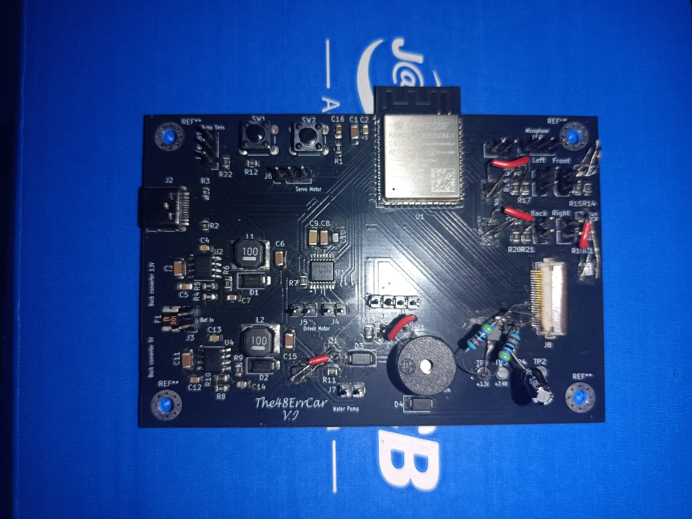
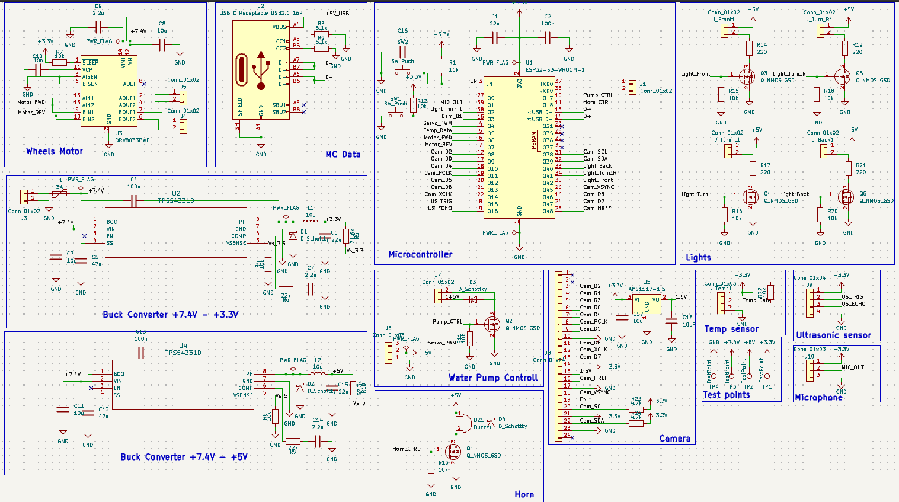
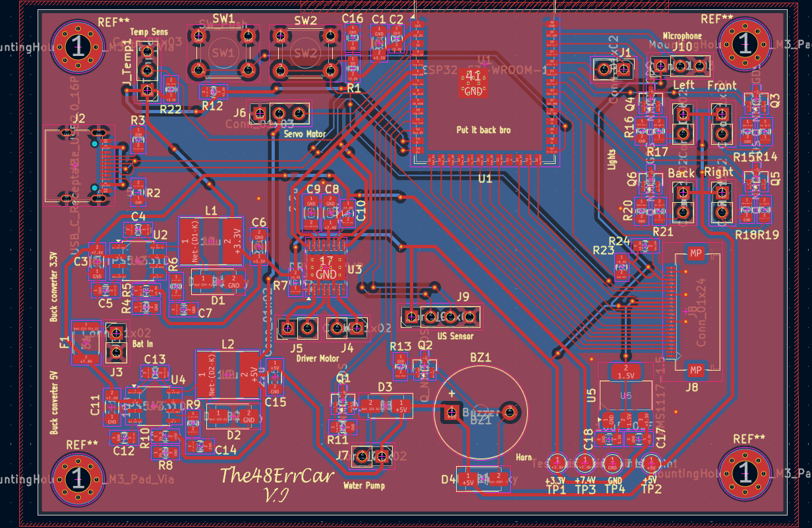
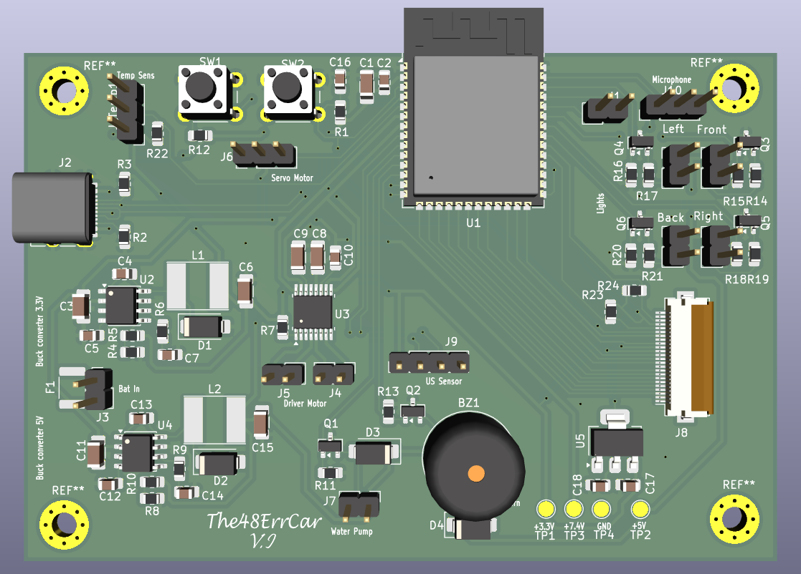
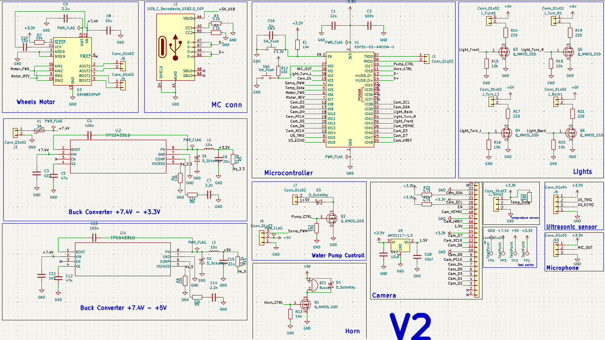
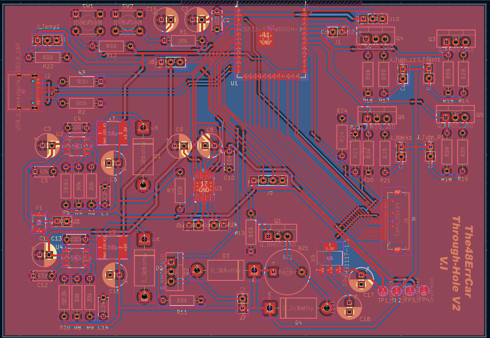
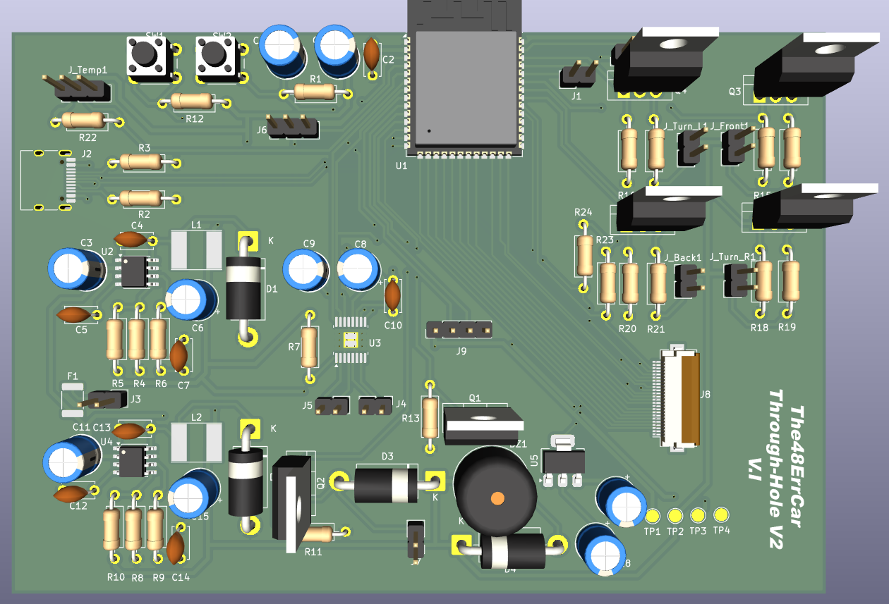
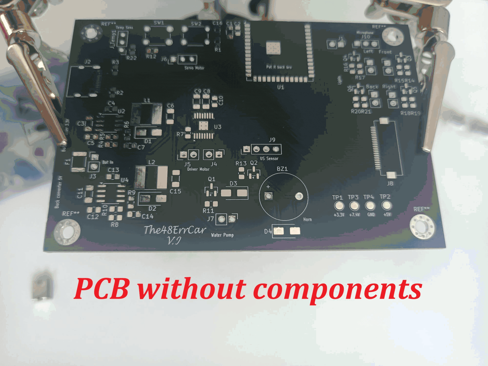

# The48ErrCar: ESP32-S3 RC Car Controller Board

A custom-designed PCB that turns an RC car chassis into a Wi-Fi-controlled, sensor-equipped vehicle, driven from a mobile app built in MIT App Inventor.

I designed the board from scratch in KiCad, wrote the firmware in C (ESP-IDF) with the help of AI, hand-soldered every component, and built the control app. This was my first PCB project, so this repository also documents what went wrong and what I learned from it.



---

## Highlights

- **Custom 2-layer PCB** designed in KiCad, with an ESP32-S3-WROOM-1 at its core
- **Two buck converters** from a 7.4 V battery pack (2x 18650 in series): one to 3.3 V for logic, one to 5 V for peripherals
- **Dual-motor-pair drive** through a DRV8833 H-bridge, plus servo steering
- **Wi-Fi control**: the ESP32 hosts its own access point and a small web server, and the phone app talks to it over HTTP
- **Native USB-C programming** through the ESP32-S3's built-in USB controller, so no USB-to-serial chip is needed
- **Hand-assembled** with a soldering iron and heat gun (SMD, 0805/1206 passives, SOIC and HTSSOP packages)

---

## Features

| Feature | Status | Notes |
|---|---|---|
| Forward / reverse drive | Working | PWM speed control through DRV8833 |
| Steering | Working | Servo driven by PWM |
| Front headlights | Working | N-MOS low-side switching |
| Brake / rear lights | Working | Automatically on when reversing or braking, with a manual override |
| Left / right turn signals | Working | Blinking at 500 ms |
| Horn / buzzer | Working | Hold-to-sound from the app |
| Water pump | Working | Low-side N-MOS switch with flyback diode |
| Temperature & humidity (DHT11) | Working | Read on demand from the app |
| Ultrasonic rear parking sensor | Working | Cuts reverse motor power at 5 cm or closer and beeps |
| Clap-controlled turn signals | Working, limited | Microphone detects volume spikes: 2 claps = left, 3 claps = right |
| Camera (OV3660, 24-pin FPC) | **Not working** | See [Known issues](#known-issues) |

---

## System overview

```
                    2x 18650 (≅7.4 V)
                           |
                   [3A PTC polyfuse]
                           |
          +----------------+----------------+
          |                |                |
   Buck -> 3.3 V     Buck -> 5 V        Motor supply
   (TPS54331)        (TPS54331)           (7.4 V)
          |                |                |
   ESP32-S3, DHT11,   Servo, pump,       DRV8833
   mic, camera LDO    buzzer, US sensor   -> L / R motor pairs
          |
   ESP32-S3 (Wi-Fi AP + HTTP server)
          ^
          | HTTP over Wi-Fi
          |
   MIT App Inventor app (phone)
```



---

## Hardware

### Power

- **Battery:** 7.4 V (2x Li-Ion 18650 in series), protected by a **3 A resettable PTC polyfuse**.
- **3.3 V rail:** TPS54331 buck converter, 10 µH inductor, 22 µF output capacitor. Feedback divider 31.6 kΩ / 10 kΩ gives about 3.33 V. Soft-start, bootstrap and compensation networks are included.
- **5 V rail:** a second TPS54331 stage (52.3 kΩ / 10 kΩ divider) for the servo, pump, buzzer and ultrasonic sensor.
- **Why buck converters instead of linear regulators:** they step the voltage down by fast switching rather than burning the difference as heat, which matters when running from a battery.
- **Test points** on +7.4 V, +5 V, +3.3 V and GND for easy debugging.

### Microcontroller

- **ESP32-S3-WROOM-1** (integrated antenna and matching network)
- Reset/boot circuitry: RC delay on `EN`, pull-ups, and two buttons for reset and download mode
- Local decoupling (22 µF + 100 nF) placed directly beside the module
- USB-C connector wired straight to the S3's native USB D+/D- (CC pull-downs of 5.1 kΩ)

### Motor driver and steering

- **DRV8833** dual H-bridge drives the left-side and right-side motor pairs (connectors J5 / J4)
- Bulk capacitor on the motor supply to absorb current spikes when starting or stalling
- Current-sense pins tied to ground (full current)
- Servo signal on a 3-pin header

### Switched loads

Water pump, buzzer and four lights (front, rear, left and right signals) each use a **logic-level N-MOSFET low-side switch** with:

- a **10 kΩ pull-down** on every gate, so nothing switches on randomly while the ESP32 is booting
- a **Schottky flyback diode** on inductive loads (pump, buzzer)
- **220 Ω** current-limiting resistors on the LEDs

### Connectors

Sensors, motors, servo, microphone and lights connect through **pin headers and jumper wires** rather than being soldered to the board, so they can be mounted wherever they fit on the chassis.

| PCB layout | 3D render |
|---|---|
|  |  |

---

## Firmware

Written in C with **ESP-IDF** and **FreeRTOS** (`main.c`).

- Starts a **Wi-Fi access point** and an **HTTP server** on the ESP32 (default address `192.168.4.1`)
- Control endpoint `/cmd?c=...` handles lights, signals, horn, pump, microphone mode and drive commands; `/dht` returns temperature and humidity
- Drive and steering use **LEDC PWM** channels
- Dedicated FreeRTOS tasks run in parallel for:
  - **turn signals / rear lights**
  - **reverse safety**, using an ultrasonic distance check that stops the motors at 5 cm or closer
  - **clap detection**, sampling the microphone through the ADC and counting volume spikes
- DHT11 is read with a custom bit-banged driver
- MJPEG camera stream server on `/stream` (disabled in practice because the camera hardware does not work, see below)

> **Security note:** the access point name and password are defined in `main.c`. Change them before using the car anywhere other than your desk.

---

## Mobile app

Built in **MIT App Inventor** (block-based). The app:

- shows an intro screen and checks the connection by pinging the car (`/cmd?c=ping`)
- enables the **Start** button only once the car answers, and shows "Connect to Wi-Fi!" if it times out
- provides the control interface for driving, lights, signals, horn, pump, temperature and microphone mode
- includes a credits screen with links to my Instagram, LinkedIn and GitHub

| Start | Credits |
|---|---|
|  |  |


The App Inventor block screenshots are in [`MIT/`](MIT).

---

## Design revisions

**V1 (fabricated and assembled)**
- Built and soldered by hand. Most of the board works, but it has the issues described below.

**V2 (current layout in this repository)**
- Corrected the MOSFET footprints (the V1 pinout was wrong, see below)
- Added a **1.5 V LDO (AMS1117-1.5)** with 2x 10 µF capacitors for the camera supply
- Added **4.7 kΩ I²C pull-ups** on the camera SDA/SCL lines
- Reworked routing around the camera connector

**V3 (through-hole version)**
- A through-hole variant of the board for easier hand assembly, built after the SMD experience


| Schematic | PCB layout | 3D render |
|---|---|---|
| |  |  |

---

## Known issues

This was my first PCB, and I would rather document the mistakes honestly than hide them:

1. **MOSFET pinout reversed.** I used an N-MOS symbol and footprint with a gate-source-drain order that doesn't match the actual SOT-23 parts. On the fabricated V1 board, the six transistors had to be fitted **upside down on the back of the board** to work. Fixed in V2.
2. **Camera does not work.** I designed for an OV2640, but the module I received from AliExpress turned out to be an OV3660. The pinout is very similar, so the firmware targets the OV3660. I didn't realise the 24-pin FPC connector is numbered 1 to 24 and wired my pin mapping in reverse. I tried a reversing workaround, but the camera never came up. The cause may also be a damaged connector or poor pad contact after rework. I also initially forgot the 1.5 V supply that the camera needs, which V2 adds.
3. **Microphone is a spike detector, not an audio input.** It only measures volume peaks, which is enough for clap detection but not for recording sound.
4. **Layout is not optimal.** The routing was rushed. The V2 layout cleans it up, but it has not been fabricated.

---

## What I learned

- Always check pin numbering and orientation against the datasheet and footprint, and verify symbol pin order, not just names
- Add pull-down resistors on MOSFET gates and understand why
- How buck converters work: feedback dividers, soft-start, bootstrap, compensation, inductor and diode placement
- The value of decoupling capacitors and keeping switching components away from the antenna
- Hand-soldering SMD parts with an iron and heat gun is hard, and rewarding
- Firmware design on ESP-IDF with FreeRTOS tasks

---

## Bill of materials (summary)

| Qty | Part |
|---|---|
| 1 | ESP32-S3-WROOM-1 |
| 2 | TPS54331D buck converter (SOIC-8) |
| 1 | DRV8833PWP motor driver (HTSSOP-16) |
| 1 | AMS1117-1.5 LDO (V2) |
| 6 | N-channel MOSFET (SOT-23) |
| 4 | Schottky diode (SMA) |
| 2 | 10 µH inductor |
| 1 | 3 A PTC resettable fuse |
| 1 | USB-C receptacle |
| 1 | 24-pin 0.5 mm FPC connector |
| 22 | 0805 resistors |
| 9 / 7 | 0805 / 1206 capacitors |
| 2 | Tactile push buttons |
| 1 | Buzzer |
| - | Pin headers |

Off-board: DC motors, servo, DHT11, HC-SR04-style ultrasonic sensor, microphone module, water pump, LEDs, 2x 18650 cells.

---

## Repository structure

```
.
|-- docs/      KiCad project, schematic, layout
|-- Through-hole/     KiCad project, schematic, layout V2
|-- MIT/           MIT App Inventor project pictures, videos, logo
|-- The48ErrCar.apk      Apk to download the app
`-- firmware.c/          ESP-32 Code

```

## Assembly

The board was assembled entirely by hand with a soldering iron and a heat gun.



## Videos

You can find videos in docs/videos folder.

## Status

The board, firmware and app work together. The car was **not assembled onto a chassis**: my focus was the PCB design, schematic and firmware, so mounting is left as a DIY step.

## Author

**Iustin George**: [GitHub](https://github.com/iustinG-afk) · [LinkedIn](www.linkedin.com/in/vrînceanu-george-iustin-437aa3331) · [Instagram](https://www.instagram.com/iustin_george10/)
